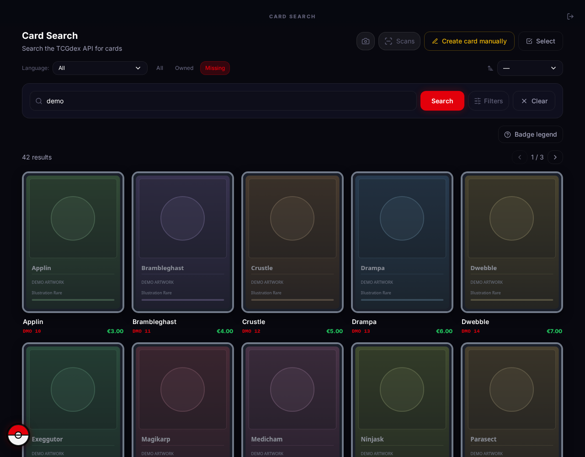

<!-- Fork release 1.57.9-11 -->
<!-- release-coverage: #38 #39 #40 -->

### Fixes and changes

**The artist views and the species views now behave the way they were meant to.**
Sixteen fixes from an independent review of the two features, applied to the
fork as well as upstream.

*Artist checklist and directory*

- A card whose display-language printing has no price now falls through to a
  priced printing in another language instead of counting as priceless, so the
  missing-value totals no longer understate what a collection is short of.
- The directory's owned/missing counts refresh after you add or remove a card
  instead of staying stale for a minute.
- **Artists** is now in the sidebar and the mobile navigation, so the directory
  is reachable without going through a card first.
- The per-card owned ratio is hidden while an ownership filter is active, where
  it could only ever read `0 / 1` or `1 / 1`.
- An artist name containing `%` survives the route, and the progress bar in the
  checklist header reads its value to screen readers.

*Species grouping*

- The species-duplicates figure loads only when its Analytics tab is opened, and
  the collection grid skips the grouping pass while grouping is off.
- Opening a printing from the species view now shows its price.
- Equal-count, equal-value species and printings keep a stable order instead of
  swapping places between visits.

### Limitations and notes

- These are the same corrections proposed upstream (Git-Romer/pokecollector
  #472 and #473); if that review asks for further changes, they will be mirrored
  here.
- A printing is still a language-specific collection row: one card owned in
  English and German counts as two printings in the species views, while the
  artist checklist and Pokédex group by card identity. That is now stated in
  the backend documentation rather than left implicit.
- No visible redesign: this release corrects behaviour, counts and navigation
  entries rather than restyling the artist or species pages, so the screenshot
  above is the only genuinely new visual state.
