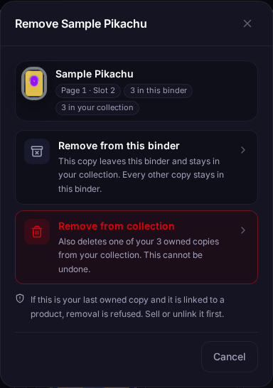
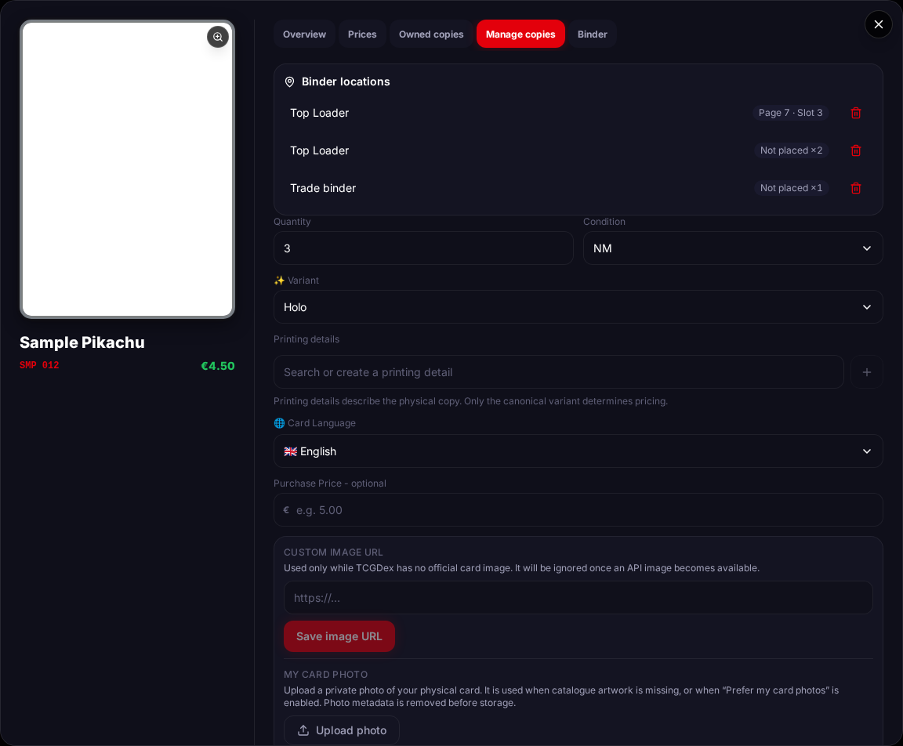
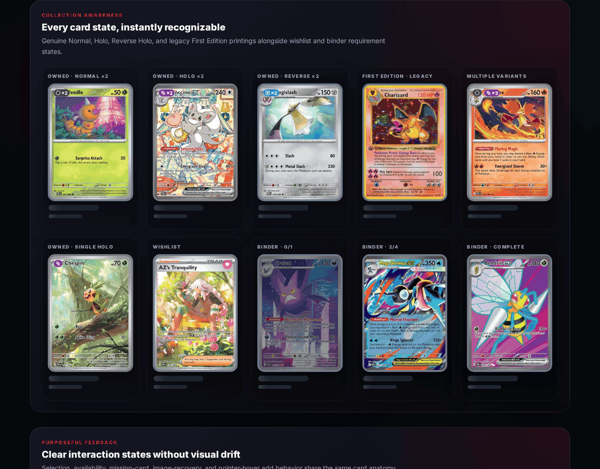
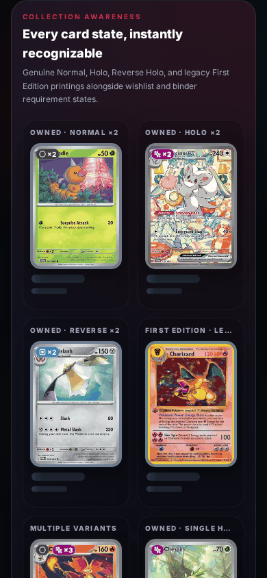

<!-- Fork release 1.57.9-12 -->
<!-- release-coverage: #43 #44 #45 -->

### Features

**A copy can now be taken out of a binder from both places binders are shown.**

- **Binder workspace.** Selecting a copy adds a destructive-toned **Remove…** action to the selection bar. The sheet names the copy again — position, copies in this binder, copies owned — and offers *Remove from this binder* (exactly that copy leaves, its pocket is freed, the owned collection copy stays; the last copy removes the entry) or *Remove from collection* (behind a second, focused confirmation; deletes one owned copy, and the last owned copy removes the collection row and its photo). The server applies one atomic, revision-checked operation, so a copy is never half-removed.
- **Card dialog.** Every private **Binder locations** row has a remove control that takes one copy out of that binder, leaving the owned copy alone. The confirm names the binder and the page/slot that becomes free, or says the remaining copies stay in *Not placed*. Public binder views render no remove control.

### Fixes and changes

**Card artwork appears immediately instead of after a multi-second wait.** Opening a card used to show a loading skeleton while the server fetched the large scan from TCGdex — one to six seconds per card whose artwork had never been viewed, because only small scans load in the grid. Two changes remove that wait:

- The card frame now paints that printing's small scan straight away and fades the large scan over it in 240 ms (instant when reduced motion is requested). Compact thumbnails keep a single image, and owner photos, custom cards and cards with no small scan keep the previous skeleton.
- The server keeps collection artwork warm: adding a card queues a background fetch of its large artwork, catalogue artwork is served from the browser cache for up to an hour (shared caches still revalidate every 60 seconds), and an existing collection can be pre-filled with `python -m scripts.warm_collection_artwork` inside the backend container. Card backs, custom images and set logos are unchanged.

### Limitations and notes

- Cached artwork is stored in the database, so it is included in database backups — roughly 50 MB for a large collection — and entries never expire on their own.
- A card added while the server's TCGdex connection is slow warms in the background; an immediate open can still wait if it races the fetch.
- Binder removal is fork-only; there is no upstream equivalent.
