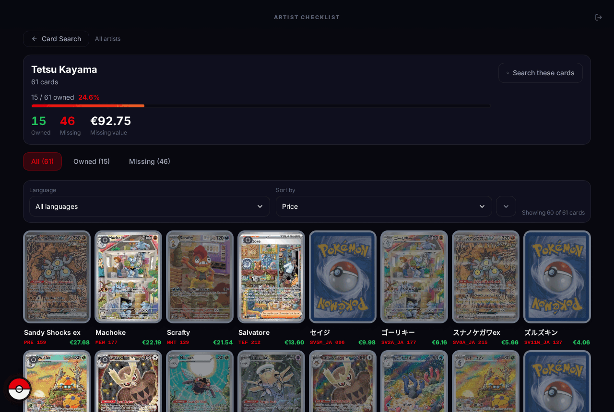
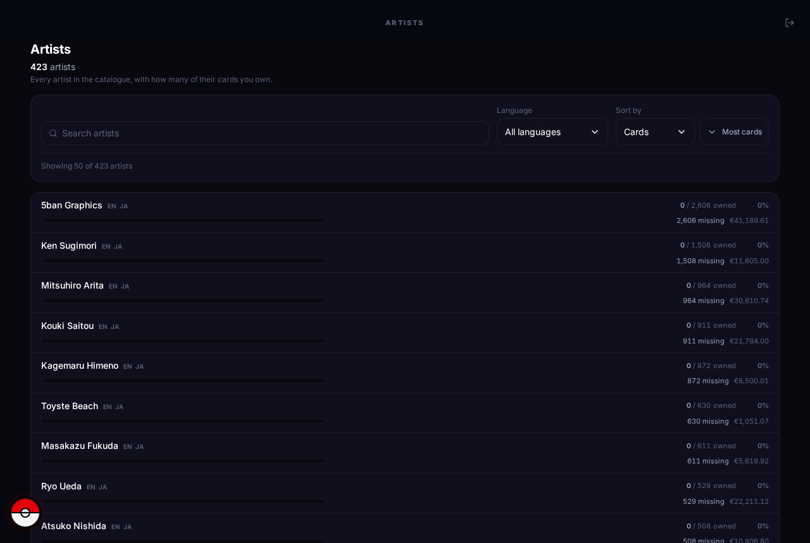
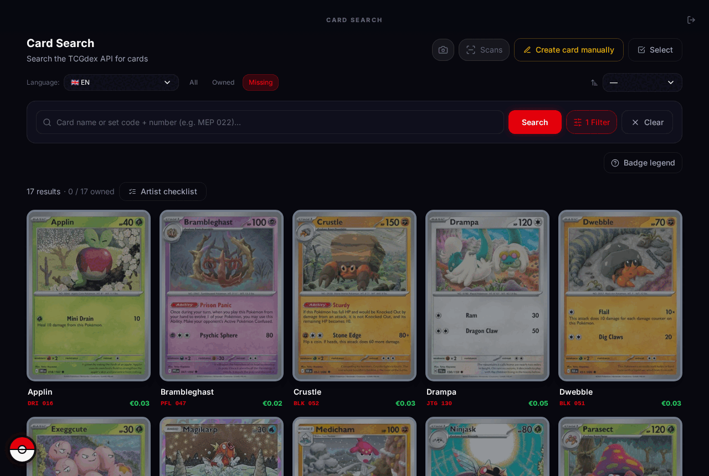
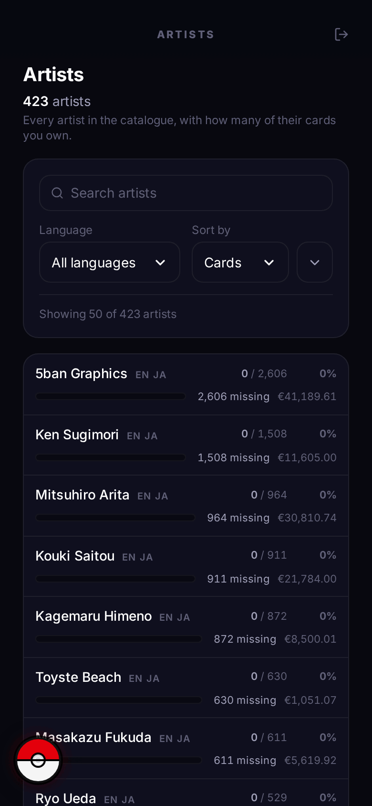

<!-- Fork release 1.57.9-4 -->

### Features

**Artist checklist.** Every card an artist illustrated, in one list, with what you
own and what you are missing. Reach it from the artist name in any card's detail
modal, from the Artist checklist shortcut in Card Search, or from the new artist
directory. The header shows owned/total, a completion bar, the number missing and
their market value; All/Owned/Missing tabs keep artist-wide counts while you page;
by default cards are grouped under their set; unowned tiles are dimmed; and cards
that exist in several languages carry a printings badge.

**Artist directory.** A searchable index of every artist in the catalogue with
per-artist progress, missing counts and missing value. Sort by name, card count,
completion or number missing; filter by language; the whole state lives in the URL.

**Ownership filters in Card Search.** All / Owned / Missing filters run on the
server, the results line reports `x / y owned`, unowned tiles are dimmed, and an
artist filter adds a one-click jump to that artist's checklist.

The directory and checklist work down to phone widths:

### Fixes and changes

- The artist credit in a card's detail modal now opens that artist's checklist
  instead of a plain search.
- Artist checklist and directory state (language, ownership filter, sort, page)
  is kept in the URL, so refresh, back/forward and shared links reproduce it.
- Adding or editing a card refreshes artist progress without a reload.

### Limitations and notes

- Cards are grouped by TCGdex card identity, so the EN, DE and JA printings of one
  card appear as a single entry. With "All languages" a card counts as owned when
  any printing is owned; choosing one language judges only that printing.
- Artist matching is an accent-insensitive substring, and artists are grouped by
  the exact credit string, so malformed upstream credits appear as their own
  entries.
- "Missing value" sums Cardmarket market prices for unowned cards and is an
  estimate, not a purchase plan.
- Coverage follows the synced catalogue: cards with no artist field are not
  listed, and only configured languages are included.
