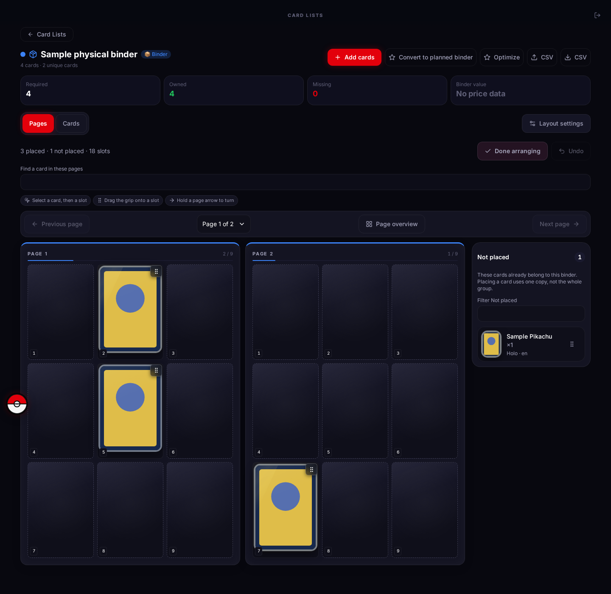
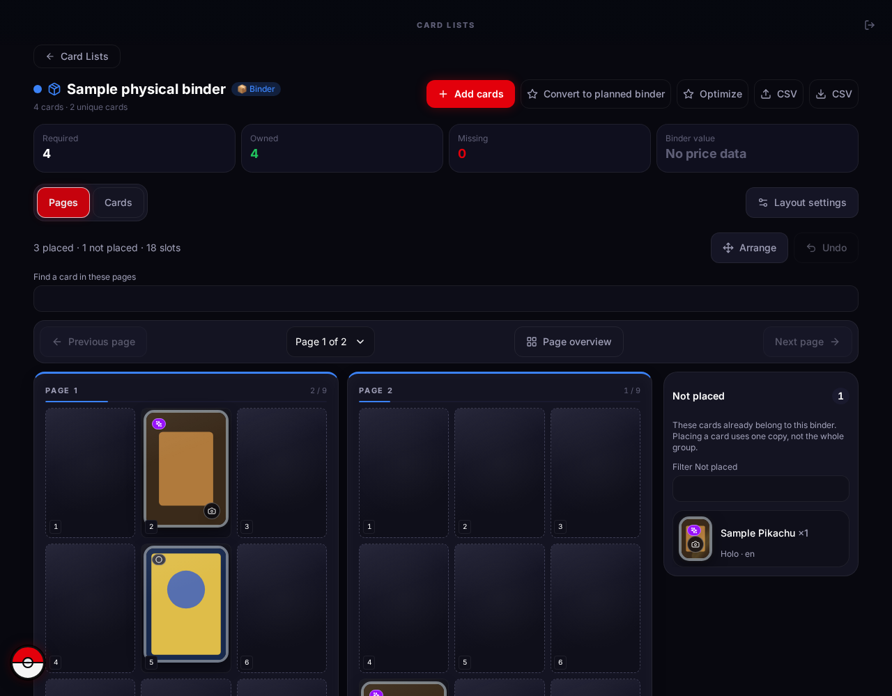
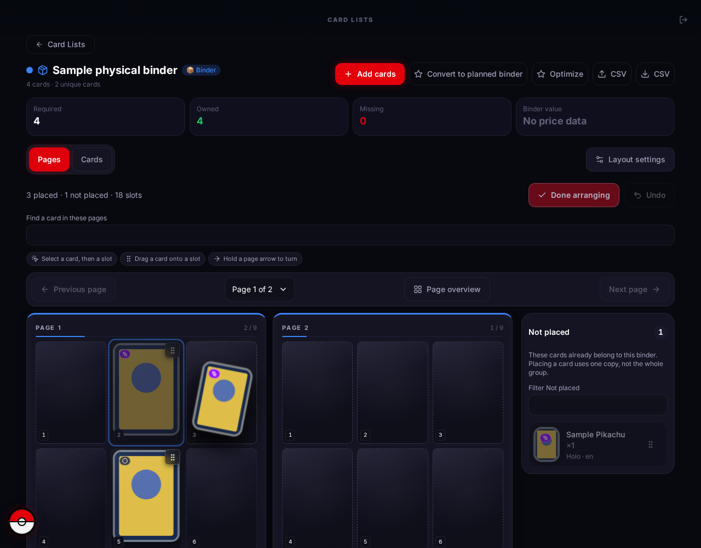
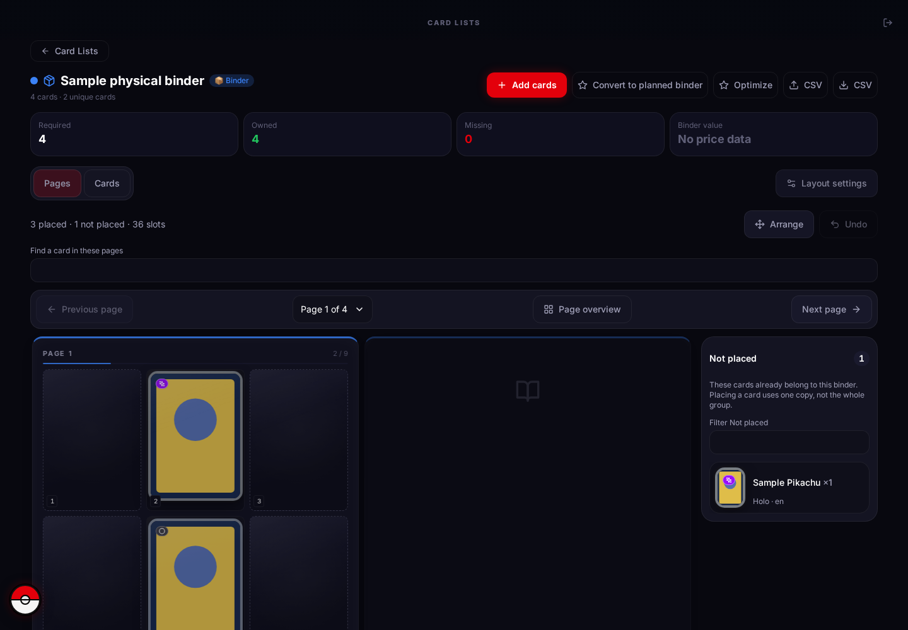
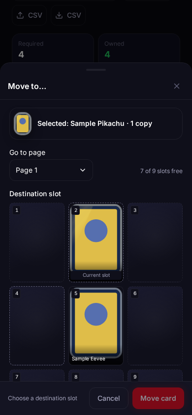

<!-- Fork release 1.57.9-5 -->

### Features

**Physical binder pages and slots.** Collection binders can be laid out as
numbered pages with real pockets — three rows and three or four columns per page
— and every placed card is one owned copy in one pocket. Turn it on from Layout
settings; nothing is rearranged for you, existing cards start in Not placed, and
placing a card takes exactly one copy rather than the whole group.

Arranging is a separate mode from browsing: select a copy and then a pocket, use
Move to… for a spatial page-and-slot chooser, drag a card onto a pocket with a
mouse or drag by its grip on a phone, or hold a page arrow to turn the page
mid-drag. Occupied destinations ask before changing anything — a placed copy
swaps with its new neighbour, a copy from the tray sends the occupant back to Not
placed. Undo reverses the last layout or placement change and refuses if
something else changed first.

Pockets carry the same detail as a collection tile: the printing, that variant's
holo treatment, and your own photo where you would normally see it.

While a copy is held it lifts off the page and leans with the direction you
drag, and the Not placed tray accepts it as a drop target of its own.

Pages can also open like a book: an optional setting shows page 1 on its own,
then 2 faces 3, 4 faces 5, and a page displayed alone sits centred instead of
beside an empty panel. It only changes presentation — no card moves.

Card dialogs list every binder location for that card — each placed copy plus
anything left unplaced — and link straight to that pocket or tray row. Public
binders show the same pages read-only, without collection details, conditions or
private photos.

**Card pickers hide cards you cannot add.** When adding cards to a binder,
wishlist or deck, entries that are already in the list or have no free copies
are no longer shown greyed out in the grid. A **Show unavailable** toggle with a
count badge reveals them on demand, placed after the selectable cards, so a
nearly complete binder can still be browsed and searched. The toggle covers the
owned-cards and all-cards tabs and the deck editor, which share the same picker.

### Fixes and changes

- When a search or filter matches only unavailable cards, the picker now says
  they are already added or unavailable instead of showing a generic empty
  state; the toggle reveals the matches.
- Clearing filters or switching between My collection and All cards hides
  unavailable cards again.

### Limitations and notes

- Physical pages apply to collection binders only. Planned binders, Planned Decks
  and Real Decks keep their current behaviour.
- Placing a card never changes collection quantities. Deleting a binder entry,
  reducing a quantity below the number placed, switching or merging prints,
  converting the binder or releasing an allocation asks you to return the chosen
  copies to Not placed first, and names the affected locations.
- Pages are numbered visible sides, not double-sided sheets.
- The three new picker strings are English-only for now; other languages fall
  back to English until translated.
- The picker's badge counts matches under the current filters. On the All cards
  tab it reflects the loaded result page, since that tab is searched
  server-side.
