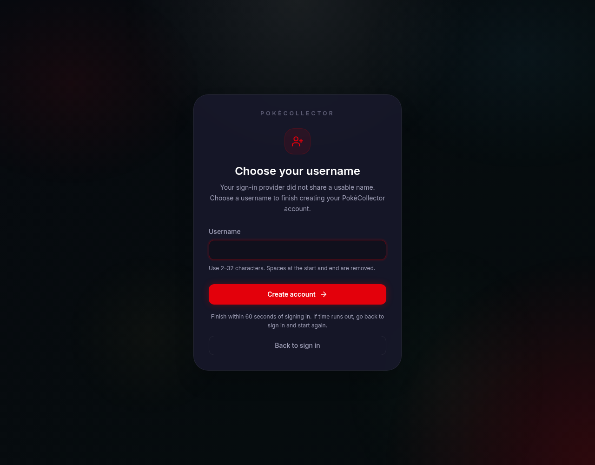
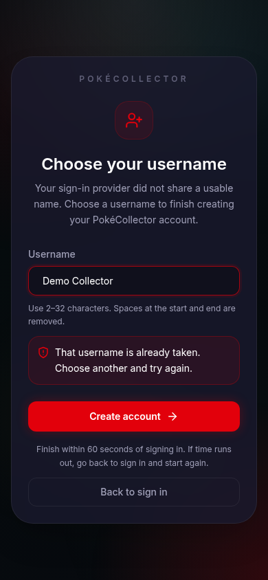
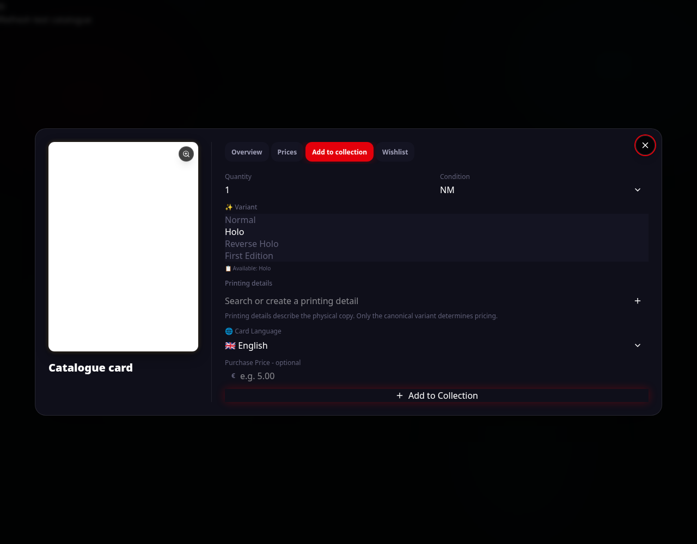
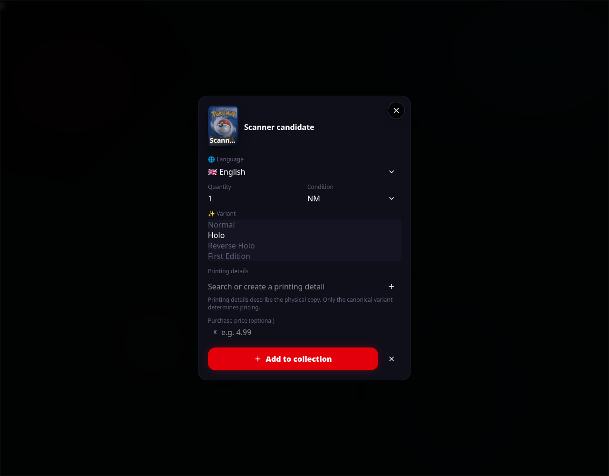

<!-- Fork release 1.57.9-8 -->
<!-- release-coverage: #26 #27 #28 #29 -->

### Features

**Sign-in with an identity provider gives new accounts a real name.** Two gaps
could leave a new account with the generic `trainer` username. Providers such as
Authelia publish `preferred_username` and `name` through their UserInfo endpoint
rather than in the ID token, and the fork only read the token. When discovery
advertises a UserInfo endpoint, the backend now fetches it after validating the
ID token, requires its `sub` to match exactly, and fills only the profile fields
the token did not supply. When a provider shares no usable name at all, the
completion page asks for one instead of inventing `trainer`.

No account, identity link or application token exists until the chosen name is
accepted, and taking a name that is already in use stays retryable rather than
ending the sign-in.

### Fixes and changes

**Finish options now follow the catalogue, not the scanner's foil guess.** When
adding a card from card detail or from scan review, all four finishes stay
visible and only a finish the catalogue positively excludes is disabled; a
positive finish price overrides a contradicting flag, and unknown or
foreign-language evidence stays editable. The submitted payload now uses the
same finish the form displays, so the stored card matches what was on screen.

- **Scan submit now names its two waits.** Browser-side shrinking shows
  `Preparing photos… 12/48` and only the actual upload shows
  `Uploading photos… 43%`, so a long downscale no longer looks like a stalled
  upload.

### Limitations and notes

- Existing OIDC accounts are unaffected: sign-in and linking resolve by exact
  issuer and subject, never rename a user, and never prompt. A provider with no
  UserInfo endpoint keeps the previous ID-token-only behaviour.
- The account-name prompt accepts 2–32 characters and stores the name exactly as
  chosen; it is not silently suffixed.
- PR titles are now checked by a `Pull Request Title` workflow against the
  Conventional Commit format. This is maintenance only and has no user-visible
  effect.
