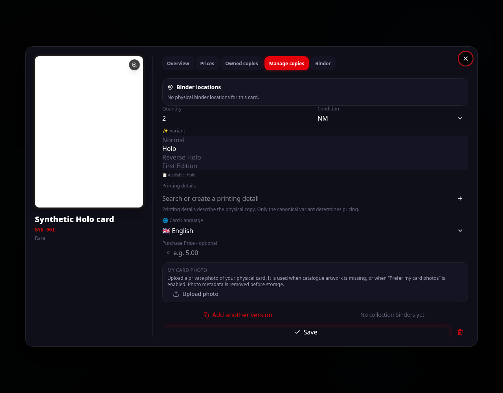
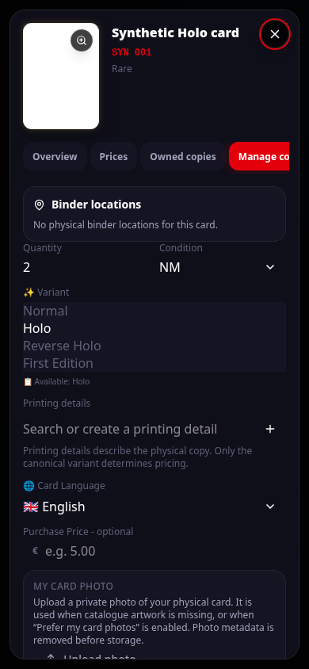

<!-- Fork release 1.57.9-9 -->
<!-- release-coverage: #33 -->

### Fixes and changes

**Manage copies now follows the catalogue's finishes.** The collection edit
form — **Manage copies** and its **Add another version** panel — used to offer
all four finishes, so a finish the catalogue explicitly excludes could still be
chosen; with quantity over one, changing it silently retagged every copy in the
row. Both selectors now use the same language-aware catalogue evidence as the
add forms: a finish with an explicit false flag and no contradicting price is
disabled, unknown evidence stays fully editable, and a different card language
is treated as unknown. The row's stored finish always remains selectable, so a
row recorded before a catalogue correction is not trapped or rewritten.

### Limitations and notes

- The gate is client-side guidance, as in the add forms; the API still accepts
  any canonical finish, so existing rows with a now-contradicted finish stay
  valid and editable.
- Changing the finish on a row with quantity over one applies the new finish to
  every copy in that row.
