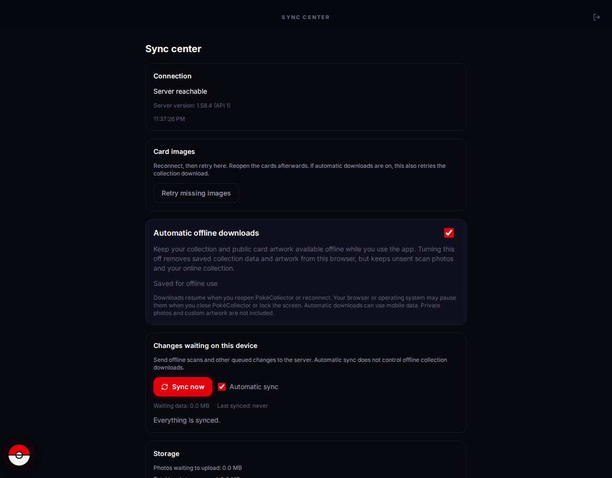
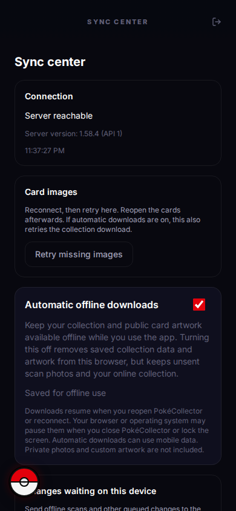
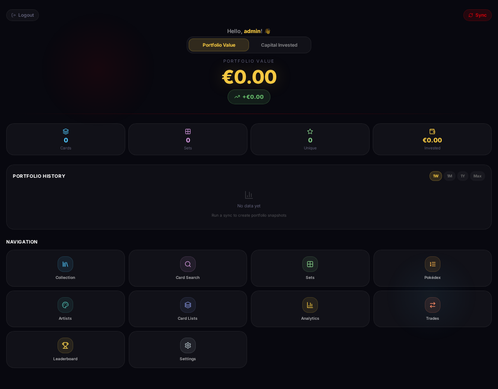
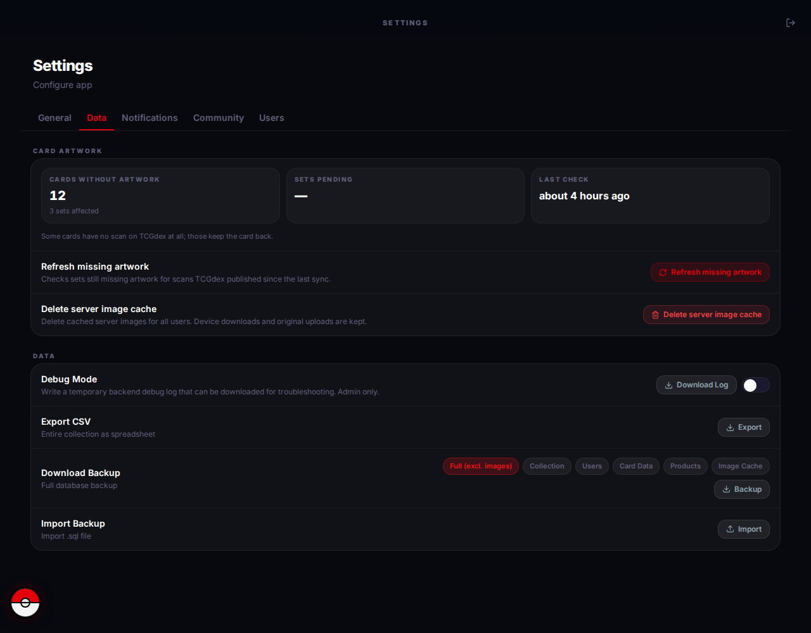
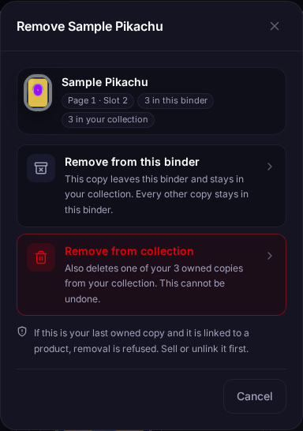
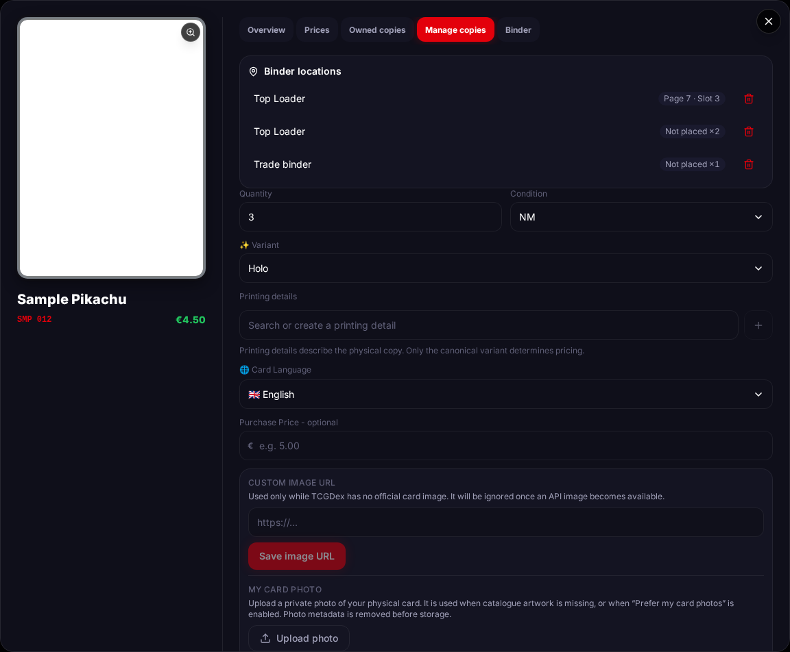
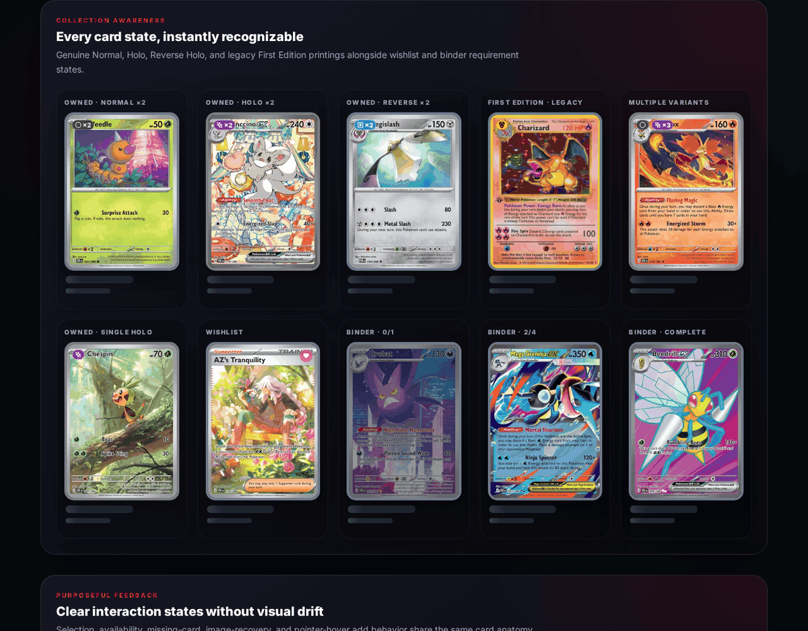
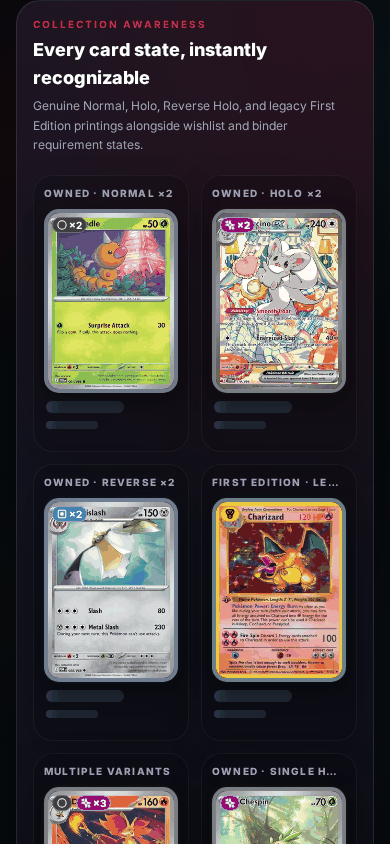

<!-- Fork release 1.58.4-1 -->
<!-- release-coverage: #43 #44 #45 #47 #48 #49 -->

### Features

**An installable app, an offline scan queue and a Sync center.** Upstream 1.58 arrives with the fork's OIDC work intact. With `PWA_ENABLED=true` on an HTTPS instance the browser can install the app and start it offline; `OFFLINE_QUEUE_ENABLED=true` adds the offline scan queue, cached sign-in and the logout guard. Both default to off, per instance.

- The **Sync center** at `/offline` gathers connection state, a "Retry missing images" action, automatic offline downloads for the collection, the changes waiting on this device, storage use, and — for administrators — the server sync controls that used to live in Settings.
- Scans taken without a connection queue on the device and replay when it returns, keeping the Card List chosen for the batch.
- Large grids are windowed: the collection, card-list pickers, public binder pages and scan review only render visible rows.
- When Cardmarket has no price for a card, the saved TCGplayer price is used (USD converted with the stored rate); German cards keep needing the existing cross-language permission. The fork's Suruga-ya JPY equivalent and hand-entered value remain the final fallback, and the UI labels that value as manual rather than market data.

**Card artwork that TCGdex publishes later is recovered.** Set syncs cannot deliver artwork, so cards whose art appeared after their first sync used to stay on the card back forever. A sweep now checks one set per request, fills only cards with no artwork at all, prioritises sets you collect or wish for, and revisits each set on a 3/7/14/30/90-day backoff; it runs every six hours and can be tuned by administrators. The new **Card artwork** panel in Settings → Data shows cards without artwork, sets pending, the last check, and a manual **Refresh missing artwork** action with live progress.

**A copy can be taken out of a binder from both places binders are shown.** In the binder workspace, selecting a copy adds a destructive-toned **Remove…** action to the selection bar: *Remove from this binder* frees exactly that pocket and keeps the owned copy, *Remove from collection* deletes one owned copy behind a second confirmation. Every private **Binder locations** row in the card dialog has its own remove control, and the confirm names the binder and the page/slot that becomes free. The server applies one atomic, revision-checked operation.

**An unmatched scan can become a card without leaving review.** When a scan matches nothing or recognition fails, the review now offers **Add card manually** next to Retry: it pre-fills the custom-card form with the scan photo, adds one owned copy, files it into the batch's destination list when one was chosen, and marks the item resolved. Retry stays available as the secondary action. No screenshot: this state needs a live unmatched scan job, and the form it opens is the existing custom-card modal.

**Card artwork appears immediately instead of after a multi-second wait.** The card frame paints that printing's small scan straight away and fades the large scan over it in 240 ms (instant with reduced motion); compact thumbnails keep one image. The server warms large artwork when you add a card, serves catalogue artwork from the browser cache for up to an hour, and an existing collection can be pre-filled with `python -m scripts.warm_collection_artwork`.

### Fixes and changes

- The full sync keeps itself scheduled: its cadence is derived from `sync_log` instead of drifting when a run is long or restarted.
- Newly detected physical sets are announced to configured Telegram recipients once per sync; digital sets are skipped.
- A custom card keeps its artwork when its catalogue identity is fixed later, and a manual scan card uses the reader's language instead of the catalogue's default.
- Price labels now distinguish a TCGplayer fallback from Cardmarket data, including in the shared card dialog and public value displays.
- Upstream dead-code and unused-dependency removal: the backend image is smaller, with no behaviour change.
- Translation updates, including new French Pokédex labels.

### Limitations and notes

- The installable app and offline queue are off by default and need a secure origin (HTTPS, or loopback in development). Turning `PWA_ENABLED` back off serves the kill worker, which removes an installed worker and its caches; queued items stay on the device if `OFFLINE_QUEUE_ENABLED` is switched off, so sync them before disabling it.
- Automatic offline downloads copy collection artwork into the browser's own storage; they are not a server backup and do not include private card photos or custom images.
- The artwork sweep and image cache live in the database, so cached artwork is part of database backups and does not expire on its own.
- The TCGplayer fallback needs a saved USD→EUR rate and never overrides a real Cardmarket price; German cards still require the cross-language permission to use it.
- Binder removal and the manual scan card are fork features; there is no upstream equivalent.
- Upgrading from 1.57.9 run a backup first: startup adds the `idempotency_keys` and `push_subscriptions` tables and the artwork-sweep columns. The migrations are additive and safe to rerun.
