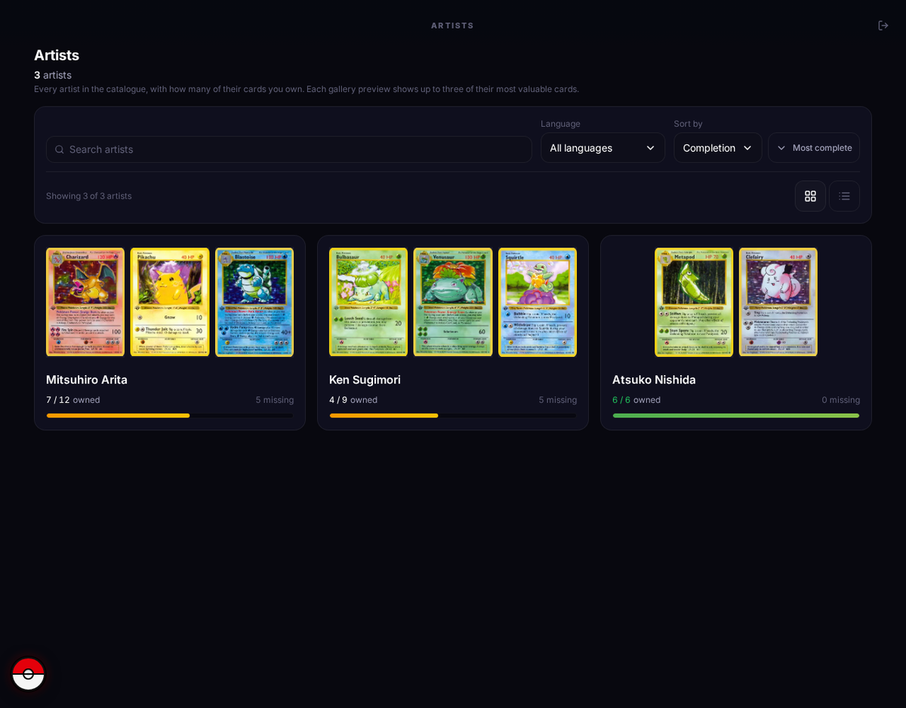
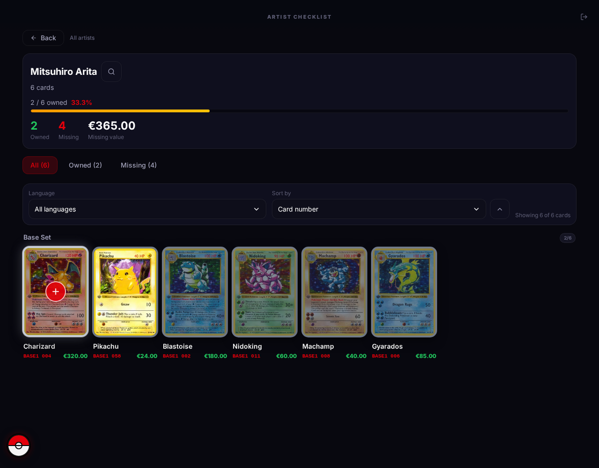
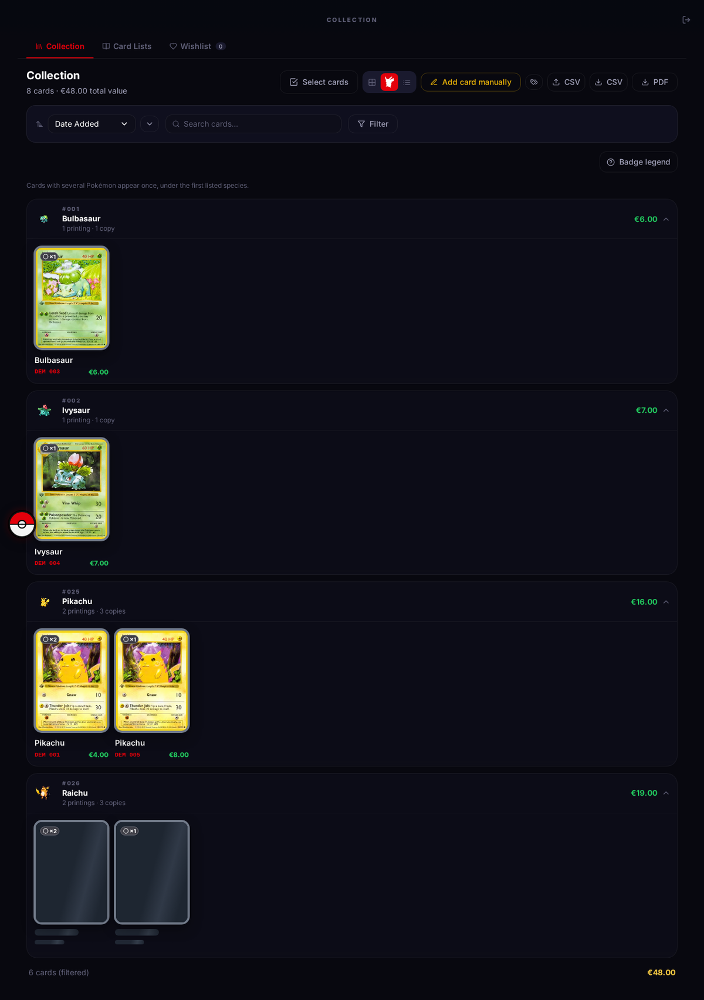
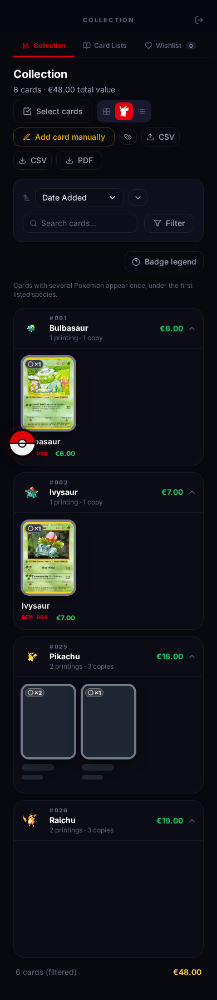
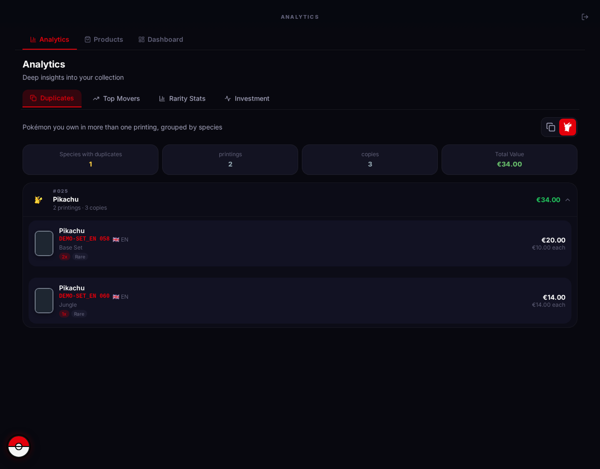

<!-- Fork release 1.60.0-1 -->
<!-- release-coverage: #52 -->

### Features

**An artist directory and a checklist for every illustrator.** The new **Artists** page lists every artist in the catalogue with how much of their work you own: search, language filter, completion sort, and a gallery of each artist's most valuable cards you have or still need. Opening an artist gives a checklist of every card they illustrated — owned and missing, completion percentage, the value of what is missing, language and sort controls, and cards grouped by set. Both pages keep their state in the URL, so a filtered checklist can be shared or reloaded. Prices use the fork's normal resolver, so Cardmarket, the TCGplayer fallback, the Suruga-ya yen equivalent and a manual value all appear consistently.

**Your collection and its duplicates, grouped by Pokémon species.** The collection gains a **By Pokémon** view beside the grid and list views. Each group shows the species sprite, dex number, the name in your language, its printing and copy counts, and its value; groups collapse and expand, and the view follows the search and filters you already have. Cards that depict more than one Pokémon appear once under the first listed species and are marked as multi-species; Trainers, Energy and manual cards stay reachable in an **Other cards** group. Analytics → Duplicates gains the same **By Pokémon** switch: every species you own in two or more printings, with a summary and an expandable list of printings, quantities and prices.

**Upstream 1.60.0, with every fork feature intact.** This release moves the fork from upstream 1.58.4 to 1.60.0. The artist and species work above is the upstream-reviewed form of features first developed here, and it replaces the fork's older implementations. OIDC sign-in, the scan batch destination and quick add, the artwork recovery sweep and cache, the Suruga-ya/manual pricing chain, physical binder pages and slots, photo compression, and the fork's deployment and release tooling are all unchanged.

### Fixes and changes

- Removed the fork's duplicate Pokédex directory route and species helper: the compatibility `/api/pokedex/directory` route and the newer `/api/pokedex/species` both remain, backed by one implementation.
- Removed duplicate German translation keys introduced by the overlap, while keeping the localized `variants` namespaces the components still request.
- Artist and species grids are windowed, so large catalogues and collections render only the visible cards.
- The merged artist implementation keeps the fork's manual-price and TCGplayer-fallback provenance in its previews and missing-value totals.

### Limitations and notes

- No database migration beyond 1.58.4. This release changes no schema; startup remains additive and safe to rerun.
- A card that depicts several Pokémon is grouped once, under its first dex id, and marked as multi-species rather than repeated in every group.
- Artist names and species names come from the synced catalogue and Pokédex metadata. Cards without artist or dex metadata are not listed under those views.
- The artist and species views are available in every interface language, with species names falling back to English where a translated Pokédex name is not available.
- Screenshots use demo data only.
